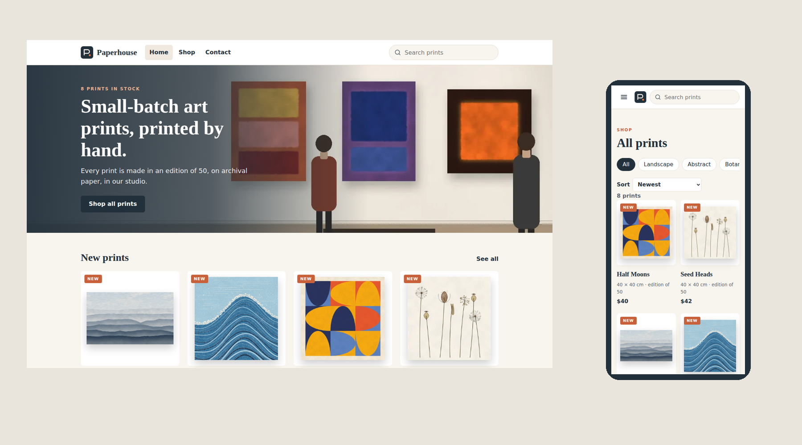
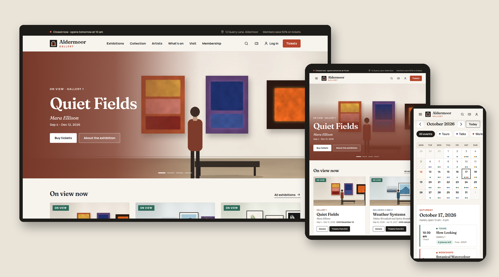

# SkyNet Agent

Build complete websites on the **SkyNet Framework** (ASP.NET Core, .NET 10) by describing them in one sentence. The agent plans the site, waits for your "go", then writes every page, paints original images, checks the layout on desktop, tablet and phone, and hands you a project that runs in Visual Studio.

The website is ready for real use: every form saves (messages, sign-ups, orders, bookings). A run-mode switch in `application.cfg` pre-fills the staff sign-in for a public showcase (Demo) or asks for real accounts (Production). The sample brand, products and team are placeholders for you to replace.



This guide is for Windows. You need **Visual Studio** and a paid **Claude plan (Pro or Max)**; the free plan does not include Claude Code.

---

## Part 1 - Prerequisites for using Claude Code (one time only)

Open **PowerShell** (Start menu, type `PowerShell`). Run only the lines for the tools you don't have yet.

### 1. Install the tools

- .NET 10 SDK - builds and runs the websites

```powershell
winget install Microsoft.DotNet.SDK.10
```

- Git - Claude Code uses it to run commands

```powershell
winget install Git.Git
```

- Python - the agent paints the website images with it

```powershell
winget install Python.Python.3.12
```

- Node.js - the agent uses it to screenshot and test your pages

```powershell
winget install OpenJS.NodeJS.LTS
```

- Claude Code - the AI that runs the agent

```powershell
irm https://claude.ai/install.ps1 | iex
```

**Now close PowerShell and open a new one**, so it can find the new tools.

- Image libraries for Python

```powershell
py -m pip install pillow numpy scipy
```

### 2. Create a folder for your website projects

- Creates the folder

```powershell
mkdir C:\WebSites
```

- Moves into it

```powershell
cd C:\WebSites
```

- Installs the page-testing tool into this folder

```powershell
npm i playwright
```

- Downloads the hidden browser the tests use (about 150 MB)

```powershell
npx playwright install chromium
```

### 3. Sign in to Claude Code

- Starts Claude Code

```powershell
claude
```

- Signs in: choose **Claude account with subscription** and sign in in the browser

```
/login
```

- Returns to PowerShell

```
/exit
```

### 4. Install the SkyNet Agent

- Adds this repository as a source of plugins

```powershell
claude plugin marketplace add hkim6000/SkyNet-Agent
```

> Downloaded the ZIP instead? Unzip it to `C:\SkyNet-Agent` and run `claude plugin marketplace add C:\SkyNet-Agent`. Use the folder that contains `.claude-plugin` and `plugins`.

- Installs the agent

```powershell
claude plugin install skynet@skynet-agent
```

### 5. Checkpoint

- Checks the agent is installed

```powershell
claude plugin list
```

You should see:

```
Installed plugins:

  > skynet@skynet-agent
    Version: 1.0.8
    Scope: user
    Status: √ enabled
```

Prerequisites are done. You never need to repeat Part 1.

---

## Part 2 - Building a website

### 1. Create an empty project in Visual Studio

**File → New → Project → ASP.NET Core Empty**

- Project name: `Bakery`
- Location: `C:\WebSites`
- Tick **Place solution and project in the same directory**
- Framework: **.NET 10**

### 2. Open a terminal inside Visual Studio

**Tools → Command Line → Developer PowerShell**

### 3. Start Claude Code in the project folder

- Moves into your project

```powershell
cd C:\WebSites\Bakery
```

- Starts Claude Code

```powershell
claude
```

### 4. Describe your website

- Tells the agent what to build

```
/skynet:site a bakery website with online orders. Build it in this existing project in the current folder; do not create a new folder.
```

Tip: type `/skynet` and pick **skynet:site** from the list that pops up, then type your description. Describe anything: a yoga studio, a dentist, a car wash, a photo portfolio.

### 5. Review the plan and say go

The agent replies with a plan: brand name, colours, pages, features and images. Ask for changes in plain words ("add a catering page", "use dark green"), then:

- Starts the build

```
go
```

When it asks permission to run commands or write files, choose **Yes**. Building takes about 10-20 minutes for a brochure site and up to an hour for a site with a staff area, customer accounts and payments. The agent cannot finish while its own tests are still running, so a long quiet spell at the end is the verification, not a hang.

### 6. Run it

When the agent says it is done, go back to Visual Studio. If it asks to reload the project, choose **Reload All**. Press **F5**.

Your website opens in the browser.

### 7. Sign in to the admin (sites with a staff area)

- Open the sign-in page: click **Staff sign in** in the website footer, or add `/AdminLogin` to the address in the browser, for example `http://localhost:5180/AdminLogin`. A site with customer accounts has a **Sign in** button in the header that offers both the customer and the staff sign-in.
- The page shows the first user name, `admin`, and a password made just for your site. It is shown only on your computer, and is also saved in `appConfig\initial-admin.txt`.
- Sign in and choose your own password. The box and the file disappear.
- Open **Users** and add an account for each person who works on the site.

---

## Before you publish

- Give the website write access to the `data`, `temp` and `appConfig` folders (on IIS: **Modify** for the application pool).
- Use HTTPS.
- Nobody has signed in yet? Read the first password from `appConfig\initial-admin.txt` on the server.
- Open `https://your-site/data/staff.json` and `https://your-site/appConfig/initial-admin.txt` in a browser. Both must show "not found" (404).
- Publishing again later: download the live `data` folder first, so messages, orders and staff accounts are not overwritten.
- A site with customer accounts emails password-reset links: fill in the `app.mail.*` lines of `appConfig\application.cfg` (server, port, address, user, password). Until then the site tells customers to contact you, and staff reset passwords from the customer's record.

---

## Changing your website

Stay in Claude Code and ask in plain words:

```
make the header darker
add an FAQ page linked from the footer
the order total should include a 5% service charge
```

The agent changes only what you ask, checks it again, and tells you when to press F5.

## Updating the SkyNet Agent

- Downloads the newest version of the agent

```powershell
claude plugin update skynet@skynet-agent
```

- Or, inside Claude Code: type `/plugin`, open **Marketplaces**, choose **skynet-agent**, then **Update marketplace**. Choose **Enable auto-update** there to get new versions automatically.

Then start a new Claude Code session (or type `/reload-plugins`). Installed from the ZIP? Download and unzip the new ZIP over `C:\SkyNet-Agent` first.

## Commands

| Command | What it does |
|---|---|
| `/skynet:site <description>` | Build a new website |
| `/skynet:page <description>` | Add one page to your website |
| `/skynet:sql-page <table and columns>` | Add a page that lists, adds, edits and deletes rows in a SQL Server table |
| `/skynet:verify` | Check the whole site again (build, layout, buttons and forms) |
| `/skynet:manual` | Write a user manual for your finished website: one HTML file with screenshots, diagrams and search |

Every command shows a plan first and waits for **go**.

## Common problems

| Problem | Fix |
|---|---|
| `git`, `claude` or `dotnet` "is not recognized" | Close PowerShell (or Visual Studio) and open it again |
| `running scripts is disabled` when using npm | Run `Set-ExecutionPolicy -Scope CurrentUser RemoteSigned`, then try again |
| Claude Code says **Not logged in** or **API Usage Billing** | Type `/login` and choose your subscription account |
| `Unknown command: /skynet:` | There is a space after `skynet:`. Type `/skynet` and pick from the list |
| `/skynet` shows nothing | Run `claude plugin list` in PowerShell; if `skynet` is missing, repeat Part 1 step 4 |
| Lost the first admin password before using it | Delete `appConfig\initial-admin.txt` and open the sign-in page again; a new one is made |
| Locked out of every manager account | Remove the managers from `data\staff.json` and open the sign-in page; a new first password is made |

## What's new in 1.0.8

- **Frame classes stay on the frame.** `check_sources.py` fails a page whose C# or JavaScript writes the page's header, footer, menu or wrapper class (`xx-head`, `xx-foot`, `xx-nav`, `xx-site`) into content, where the frame's CSS turns a card bottom into a dark footer band. Card parts are `xx-chead` and `xx-cfoot` (design.md).
- **Art at thumbnail size.** The art skill checks every painted set at the size the page shows it; a light object on a light ground gets a shadow, rim or outline, and the whole set is repainted together.

## What's new in 1.0.7

- **The agent cannot finish early.** A plugin Stop hook (`hooks/hooks.json`, `scripts/still_running.sh`) refuses to end the turn while a preview server, `dotnet`, a screenshot or an interaction script started under the working folder is still running; the builder waits, reads the result, then reports. Verify now runs read-only checks first, record-adding flows next and the destructive tests (Initialize data, the first Production start) last, on restored data.
- **Customer accounts** (`reference/accounts.md` + code): the header's Sign in opens a gateway with a customer card and a staff card; every footer links to Staff sign in; sign-up asks for a phone number; the account page has Edit profile and Change password; **Forgot your password?** emails a one-hour, single-use reset link through the `app.mail.*` settings (`Mailer.cs`), and says whom to contact until mail is set up. In Demo both sign-in forms are pre-filled and list the sample logins.
- **Home slideshow as a developer option** (`reference/code/slideshow/`): the plan asks "one picture, or a slideshow of the building and rooms every 7 seconds?"; the code gives the Pages editor a Slides list, dots, arrows, swipe, pause on the controls and stillness under reduced motion. The Home page top of a business with premises shows the building and its rooms.
- **New design rules:** menu labels are nouns (Certificate, not Verify); text follows the record's current state (a refunded order stops saying "access ended" once the student enrolled again); nothing clips (chart labels wrap); every payment or refund call carries an idempotency key.
- **Checks:** `check_sources.py` fails when one admin page's phone header differs from the others (the brand clipping that slipped through in 1.0.6). The manual skill's `check.js` and `capture.template.js` find Chromium the way `shots.js` does, `check.js` bans `demo1234` and `sample` by default, and the manual skill lists the capture-only patches to apply on a copy of the project, never on the delivered one.

## What's new in 1.0.6

- **Sample data and Initialize data:** every site with a staff area ships with invented records and staff for each role (password `demo1234`, no manager), so the Demo looks like a working business. On the first start in Production the site wipes them once, keeps settings, prices, pages and media, and shows a new first password; a manager can also wipe from Settings while in Demo by typing INITIALIZE.
- **README screenshots:** `readme_shots.js` makes `docs/screenshot-home.png` and `docs/screenshot-responsive.png`; `check_sources.py` fails a README without them, and warns when a site references an older SkyNet package than the starter.
- **Preview plays video:** the offline preview serves MP4 and WebM.
- **New design rules, each verified:** undo frees the source (a voided invoice puts the job back to "To invoice"); staff records are pre-filled from the customer's request; the site promises only what it does (no "we will email you" without email); rights are shown in words, not VEX; Demo text stays off Production pages.
- **Manual skill:** captures in Production mode, no "demo" word, passwords masked, one worked flow end to end, sample data as the starting point.
- **Builder:** reports what to do next, never a list of files written.

## What's new in 1.0.5

- **Packages:** the starter references `TheSkyLite.SkyNet` 1.0.6 and pins `System.Security.Cryptography.Pkcs` 10.0.13 (no more 9.0.x audit warning).
- **License:** the starter ships the template `LICENSE` (template code MIT, framework proprietary) and the README points at it.
- **Status rules by the clock:** check-in only on the visit day, no-show only after the start time, done only after check-in; the verify skill tests them with a future booking.
- **Admin on phones:** the header shows the brand and Sign out only; lists become cards below 600px.
- **Builder:** never ends a turn while a background build, test or screenshot run is still going.
- **`shots.js`:** falls back to an installed Chromium when Playwright's own browser is missing.
- `app.app.releasedate` is set to the delivery date.

## What's new in 1.0.4

- **Pages editor:** the owner edits the public pages in place: blocks for page top, text, picture and text, cards, steps, numbers, checklists, people, questions, quote, picture or video and call to action; drag or arrow to move, hide, remove, save with the last five versions kept. Parts that come from the site's data (product list, forms) stay on their page.
- **Media library:** its own staff page for photos and MP4 videos, checked by file contents, with a video size limit in Settings, a picker every other admin page reuses, and up to six photos or videos per product.
- **Demo and Production run mode:** `app.app.runmode` in `application.cfg`. Demo pre-fills the staff sign-in for a public showcase; Production is the real sign-in. Switching to Production ends demo sessions.
- **Messages** is its own staff page; "View site" opens in a new tab.
- **Payments rule:** hosted checkout must be confirmed by the provider's signed webhook, and an unpaid card order is never cancelled without asking the provider first.
- **Build fix:** the starter `.csproj` now handles `temp\*.json` the same way as `data\*.json`, so the duplicate-content error no longer appears after the first staff sign-in. `/skynet:verify` checks for it.
- **Phone header:** the shop name must stay visible at 390px; the checks look for it.

## What's new in 1.0.3

- **Catches pages a real server cannot find:** `/skynet:verify` fails when a page shares its name with another class (a `Member` model next to a `Member` page) or when a request method has a private helper with the same name. The offline check now fails on them the same way the live server does.
- **Signed-in checks:** screenshots can run with a signed-in member or staff user, and every page is checked for duplicate element ids.
- **Publishing to IIS:** a ready `web.config` in the starter project and the list of folders the app pool must be able to write.
- **Manuals:** a tip for capturing a busy working day at any hour.

## What's new in 1.0.2

- **First admin sign-in:** the sign-in page shows the first password on your computer; you choose your own at the first sign-in.
- **No demo mode:** every form saves for real; no demo accounts or demo notes.
- **`/skynet:manual`:** writes a user manual for your website.
- **Better checks:** `/skynet:verify` also finds text that runs out of its box.

## Links

- SkyNet Developer Guide: https://www.theskylite.com/documents/SkyNet_Developer_Guide.html
- Website templates (free, full source): https://www.theskylite.com/SkyNetTemp
- SkyNet on NuGet: https://www.nuget.org/packages/TheSkyLite.SkyNet
- YouTube: https://www.youtube.com/@hckim3948



## Showcase

Live demo and full source of websites built with SkyNet.

| Website | Live demo | Full source |
|---|---|---|
| Lumé Beauty | [theskylite.com/beauty](https://www.theskylite.com/beauty) | [GitHub](https://github.com/hkim6000/SkyNet-BeautyWebsite-Asp.net.Core-Full-Source) |
| Calvera Therapeutics | [theskylite.com/pharma](https://www.theskylite.com/pharma) | [GitHub](https://github.com/hkim6000/SkyNet-PharmaWebsite-Asp.net.Core-Full-Source) |
| Northbound Notes | [theskylite.com/travel](https://www.theskylite.com/travel) | [GitHub](https://github.com/hkim6000/SkyNet-TravelWebsite-Asp.net.Core-Full-Source) |
| Flamejack Burgers | [theskylite.com/fastfood](https://www.theskylite.com/fastfood) | [GitHub](https://github.com/hkim6000/SkyNet-FastFoodWebsite-Asp.net.Core-Full-Source) |
| Aurelle | [theskylite.com/FineDining](https://www.theskylite.com/FineDining) | [GitHub](https://github.com/hkim6000/SkyNet-FineDiningWebsite-Asp.net.Core-Full-Source) |
| Crestline Motors | [theskylite.com/CarDealer](https://www.theskylite.com/CarDealer) | [GitHub](https://github.com/hkim6000/SkyNet-CarDealerWebsite-Asp.net.Core-Full-Source) |
| Panelmoon | [theskylite.com/WebComic](https://www.theskylite.com/WebComic) | [GitHub](https://github.com/hkim6000/SkyNet-WebComicWebsite-Asp.net.Core-Full-Source) |
| Aldermoor Gallery | [theskylite.com/ArtGallery](https://www.theskylite.com/ArtGallery) | [GitHub](https://github.com/hkim6000/SkyNet-ArtGalleryWebsite-Asp.net.Core-Full-Source) |

## License

The files in this repository are under **Part A (MIT)** of the [SkyLite & SkyNet Framework License](LICENSE). The SkyNet Framework itself (`SkyNet.dll` in the TheSkyLite.SkyNet package) is covered by **Part B**: proprietary, free to use, not open source.
